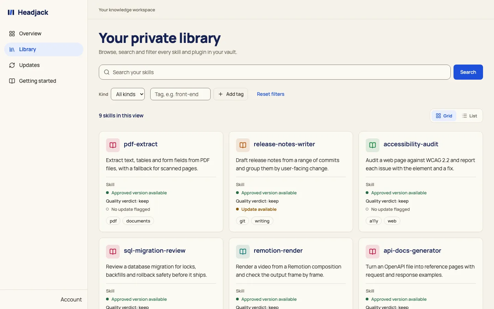
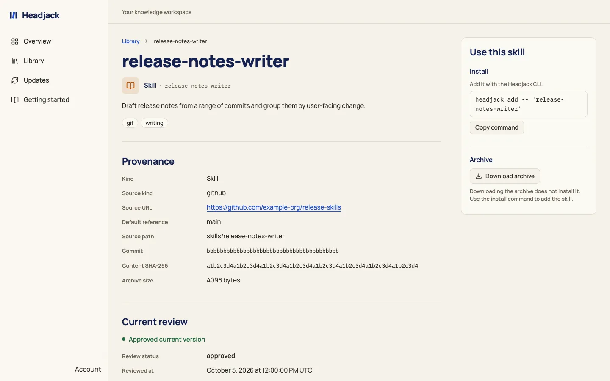
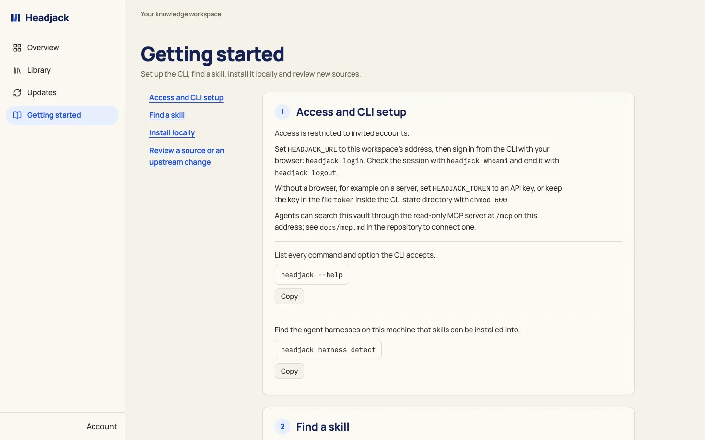
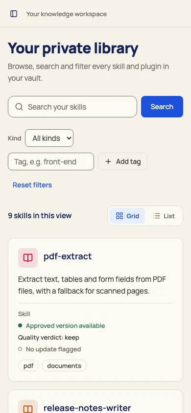

<p align="center">
  
</p>

<h1 align="center">Headjack</h1>

<p align="center">
  A private vault for agent skills: review a skill once, find it by meaning, install it only when a task needs it.
</p>


Headjack keeps your agent skills and plugins in one catalog of your own instead of loading them everywhere. You review a
skill once and store it; an agent then finds it by meaning and installs it into Claude Code, Codex, Grok, Gemini CLI,
Cursor or another agent harness only when a task needs it. Keeping skills in the vault keeps each session's context small.

It has three parts:

- **The `headjack` CLI**, which searches the vault and links skills into each harness's skills directory, scoped to a
  project or a session when you ask. The `skill-finder` skill teaches an agent to use it, and the `writing-skills`
  skill teaches an agent to write a skill that `skill-finder` finds, proving it in a scratch vault
  ([`writing-skills/SKILL.md`](writing-skills/SKILL.md)). It has no npm dependencies.
- **A local MCP server**, `headjack mcp`, for agents that search the vault over the Model Context Protocol, without a
  shell (see [`docs/mcp.md`](docs/mcp.md)).
- **A hosted instance**, invite-only: a web app, a REST API and a read-only MCP route on top of the same catalog (see
  the hosted section [below](#hosted-invite-only)).

The CLI runs in two modes. **Local mode** keeps the vault in a SQLite file on your machine (`~/.headjack/vault.db`) and
needs no server, no account and no network for search; it is the default when `HEADJACK_URL` is unset, and
`HEADJACK_MODE=local|remote` overrides. It needs **Node 22.16 or later, or Node 24 or later**, because the SQLite bundled in
earlier releases lacks the full-text index it relies on; the CLI checks this and says so when it is not met. Search is
keyword search over each skill's name, description, tags and body, and local mode is single-user, one vault per machine.
**Hosted mode** talks to the invite-only instance and needs only Node 20.9 or later.

## Quickstart: local

The vault lives on your machine; nothing is uploaded anywhere. You need Node 22.16 or later (or Node 24+). The loop is three
commands:

```sh
headjack search "render a video with remotion"     # find a skill
headjack add remotion-render --to claude           # link it into a harness, only when the task needs it
headjack mcp                                       # or let an agent search and get the install command over MCP
```

To get there:

1. **Get the code and load the plugin.** Clone this repository, then load it as a plugin for a Claude Code session
   (Claude Code 2.1.275 or later):

   ```sh
   git clone https://github.com/Montinou/headjack.git
   claude --plugin-dir /path/to/headjack
   ```

   The plugin registers the local MCP server, and its `skill-finder` skill tells the agent to run the CLI through the
   plugin's launcher, `cli/headjack`. The vault itself stays in `~/.headjack`, outside the plugin, so a plugin update never
   touches it.
2. **Let your terminal find `headjack` too.** The plugin puts nothing on the `PATH` of your own terminal. Skip this step
   only if you never type `headjack` yourself; the next steps are commands you run in your own terminal, and
   `import --interactive` asks you questions an agent's shell cannot answer. Link the launcher once from your clone. Do not
   link into the plugin's own directory: that link dangles after a plugin update.

   ```sh
   mkdir -p ~/.local/bin
   ln -s "$PWD/cli/headjack" ~/.local/bin/headjack     # run from your clone; ~/.local/bin must be on your PATH
   ```

3. **See what would be imported.** This scans `~/.agents/skills` and the Claude, Codex and Grok skills directories,
   changes nothing in the vault and writes `<state dir>/import-plan.json`:

   ```sh
   headjack import --dry-run
   ```

4. **Import, deciding per entry.** The command asks about each pending skill; nothing is stored unless you answer yes.
   Importing a skill that is already in the vault changes nothing:

   ```sh
   headjack import --interactive
   ```

5. **Search and install.**

   ```sh
   headjack search "render a video with remotion"
   headjack add remotion-render --to claude
   headjack updates                       # upstream changes waiting for review
   ```

`headjack whoami` prints the vault path and how many skills it holds. `HEADJACK_MODE=local` stays local even when
`HEADJACK_URL` is set, and `HEADJACK_MODE=remote` insists on hosted mode. `HEADJACK_HOME` moves the state directory, and
`HEADJACK_UPDATE_TTL_HOURS` sets how long an upstream check stays fresh (6 hours by default; 0 checks every time). The
`vault.db` file is mode 600 in a directory of mode 700.

## Install from npm

The CLI and the local MCP server are also published to npm as `@triqual/headjack`, with no dependencies. It needs Node
22.16 or later. A global install is the way to use it as an MCP server, because it puts `headjack` on your `PATH`:

```sh
npm install -g @triqual/headjack
headjack --help
```

Then point any MCP client at it over stdio:

```json
{
  "mcpServers": {
    "headjack": { "command": "headjack", "args": ["mcp"] }
  }
}
```

If the Headjack plugin is installed in Claude Code, skip this entry there: the plugin already runs the same MCP server,
and a second one shows every tool twice. Use the entry for other clients (Codex, Cursor and the rest).

To try it without installing anything, run it through `npx`:

```sh
npx -y @triqual/headjack mcp
```

The commands the MCP tools hand back (the install command, the login hint) start with `headjack`, so running them needs
the global install. The npm package is the CLI, the MCP server and the `skill-finder` skill; the Claude Code plugin's
prompt hooks still come from the plugin (see [Quickstart: local](https://github.com/Montinou/headjack#quickstart-local)
and [`docs/mcp.md`](https://github.com/Montinou/headjack/blob/main/docs/mcp.md)).

## The web app

The hosted instance shows the same catalog in a web app. These screenshots come from the fixture server with made-up
skills, not from anyone's vault.

Local mode has no web interface yet: the CLI and the local MCP server are how you use it. A local web interface over the
SQLite vault (`headjack ui`, single-user, no sign-in) is planned.









## Hosted (invite-only)

The hosted instance is a web app, a REST API and a read-only MCP route, backed by Postgres with hybrid search (full-text
plus vector embeddings, fused with reciprocal rank fusion). Access is by invitation. The instance address and the
`headjack-mcp` client id come with the invitation: they are not published here, and this repository offers no way to run an
instance of your own; the maintainers' operating notes are in [`docs/operations.md`](docs/operations.md).

With an invitation, point the CLI at the instance. `HEADJACK_URL` must be `https`, or `http` on a loopback host, with no
credentials, query or fragment (the CLI refuses such a URL without echoing it). It is normalized: host in lowercase, no
default port, no trailing slash. It must also equal the server's canonical origin: another domain that serves the same
deployment is refused with "describes a different resource".

```sh
export HEADJACK_URL="https://headjack.example.invalid"   # the address from your invitation
headjack login            # opens the browser; the URL is always printed too
headjack whoami           # credential kind and source, email and expiry, and whether the server accepts it
headjack logout           # revokes the login at the issuer and deletes the saved credential
```

`login` listens on `127.0.0.1` on the first free port of 53437, 53438 and 53439 for the browser's redirect, and gives up
after 5 minutes. It saves the login in `<state dir>/token` (mode 600), and the CLI refreshes it on its own; if the refresh
is refused it says `session expired: run headjack login`. An existing login is kept unless you pass `--force`. A login
belongs to one server: with a different `HEADJACK_URL` the CLI asks you to log in again. If the server has not enabled
browser login, `login` says so and exits 2. `logout` always revokes a login; with an API key in the token file it prints
that API keys are revoked where they were issued and leaves the file in place (exit 2). Neither command prints a token.

For a machine without a browser, ask the instance's maintainers for an API key with the `skills:read` scope (and
`skills:write` for `review`). The CLI reads it from the `HEADJACK_TOKEN` environment variable first, then from the token
file, which must not be readable by others. `HEADJACK_TOKEN` takes precedence over a saved login, and `login` warns when it
is set. Run this on its own, not pasted together with other lines: its hidden prompt would take the next pasted line as the
token in a shell without bracketed paste.

```sh
mkdir -p ~/.headjack && chmod 700 ~/.headjack
(umask 077; printf 'Token: '; read -rs t; echo; printf '%s' "$t" > ~/.headjack/token) && chmod 600 ~/.headjack/token
```

**Connect an agent over the hosted MCP route.** The read-only route (`search_skills`, `get_skill`, `list_my_skills`,
`install_command`) is at `/mcp` on the instance. In Claude Code, register it with the `headjack-mcp` client id from your
invitation and sign in with `claude mcp login headjack`:

```sh
claude mcp add --transport http --scope user \
  --client-id "<the headjack-mcp client id from your invitation>" --callback-port 53436 \
  headjack "$HEADJACK_URL/mcp"
```

`docs/mcp.md` has the scopes, the callback ports and the details of both MCP routes. The CLI and the local MCP server
follow `HEADJACK_URL`: unset, they use the local vault; set, they use the instance. Your local vault is never copied
anywhere; `HEADJACK_MODE=local` brings it back at any time.

**Copy hosted skills into the local vault.** `headjack pull` copies your approved hosted skills into the local vault. It
needs `HEADJACK_URL` and a hosted credential, in either mode. A skill's archive is stored only when its content hash matches
the hosted version; its review notes and Spanish example requests come along. Plugins and the skills inside them have no
archive, so they are copied from their hosted name, description and tags: they become searchable and suggestible
locally, and `headjack add` enables the plugin in Claude Code as before. A skill you changed in the local vault after
pulling it (or that was there before any pull) is never overwritten: while hosted has a newer version it is skipped with
`run headjack pull --replace <slug> to take hosted`. Pulled skills follow hosted: `headjack updates` does not track their
upstream, so run `headjack pull` again to refresh them. It exits 1 when any skill failed.

```sh
headjack pull                     # approved skills and plugins; a re-run copies only what changed
headjack pull --replace my-skill  # take the hosted version over a local edit
```

## Usage

```sh
headjack search "render a video with remotion"          # --json for agents
headjack add remotion-render                            # link into claude, codex and grok
headjack add remotion-render --to gemini --session      # only Gemini CLI, until the next cleanup
headjack remove remotion-render
headjack cleanup --harness claude --older-than 12h      # remove --session installs
headjack harness detect                                 # record which harnesses this machine has
headjack review https://github.com/owner/repo --path skills/x   # review a source and add it to the vault
headjack updates                                        # upstream changes waiting for review
headjack verify                                         # check local copies and links against their recorded hashes
headjack suggest "deploy a next app to vercel"          # skills in the vault that fit a request and are not active yet
```

Harnesses: `claude`, `codex` and `grok` (the default for `--to`) and 24 more (`gemini`, `cursor`, `windsurf`, `cline`, and
others; the table is in `lib/harness-catalog.mjs`, and `headjack harness detect` finds the ones on your machine).
`--to all` uses the detected ones. Only `claude`, `codex` and `grok` accept `--project`. `--session` marks an install so
that `cleanup` removes it; permanent installs are never touched by `cleanup`.

To move an existing setup into the vault:

```sh
headjack import --dry-run       # writes <state dir>/import-plan.json
headjack import --interactive   # confirm each entry; nothing is uploaded by default
headjack import --trim --dry-run [--only-harness gemini,cursor]   # what a trim would remove, and why the rest stays
headjack import --trim          # back up, remove the vault copies, install skill-finder in each detected harness
headjack restore ~/.headjack/backup-<date>   # undo a trim
```

A trim removes a local copy only when it is the imported one or byte-identical to it, never through a symlinked harness
directory, and touches Claude Code plugins only when `claude` is among the trimmed harnesses. When the Headjack plugin
is enabled in Claude Code, a trim installs no separate skill-finder there: the plugin's `headjack:skill-finder` is
already loaded.

The surface that other tools may rely on (JSON shapes, exit codes, environment inputs) is pinned in
[`docs/capability-contract.md`](docs/capability-contract.md).

### State directory and `config.json`

The CLI keeps its state in `~/.headjack`, or in `HEADJACK_HOME` when set (an absolute path, or one starting with `~/`):
the vault (local mode), the token file, `state.json` (what is installed where), the local copies of installed skills,
`harnesses.json`, import plans and trim backups.

An optional `config.json` in that directory holds two lists of strings, plus the `suggest` and `enrich` sections
described under [Suggestions](#suggestions); unknown keys are ignored:

```json
{
  "excludedRoots": ["~/work"],
  "corePlugins": ["example-plugin@example-marketplace"]
}
```

- **`excludedRoots`**: directories the CLI never imports from, reviews from or installs into (for example a work
  folder whose skills must not leave the machine). Each entry is absolute or starts with `~/`.
  `HEADJACK_EXCLUDED_ROOTS` (entries separated by the platform path delimiter) replaces the list when set. Write it
  before you import or install anything.
- **`corePlugins`**: Claude Code plugins (`<plugin>@<marketplace>`) that stay enabled when `import --trim` disables
  the rest; `--keep a,b` adds to it for one run. Without it and without `--keep`, a trim leaves plugins as they are;
  with `--keep` alone, a trim disables every plugin outside the `--keep` list (`headjack restore` undoes it). The
  Headjack plugin itself always stays enabled, and `import` never offers it or its skills (`skill-finder`,
  `writing-skills`) to the vault: they ship with the plugin.

### Suggestions

The Claude Code plugin can offer vault skills while you work. With suggestions on, each prompt you send is searched
against the vault, and when a skill that is not active yet fits it well, Claude sees a short `<headjack-suggestions>`
block with the skill and the command that installs it for the session. Claude is told to offer it and to install
nothing without your OK. Suggestions are off until you turn them on:

```sh
headjack suggest --enable            # turn on; keeps the current mode (local unless --hosted was set)
headjack suggest --enable --hosted   # search the instance named by HEADJACK_URL, else suggest.url
headjack suggest --enable --local    # back to the local vault
headjack suggest --disable
```

The setting lives in `config.json`, so it applies to every Claude Code session of that user. A prompt is not searched
when it starts with `/`, is a short acknowledgement ("ok", "thanks"), sits under one of `suggest.disabledPaths`, or has
fewer than 25 useful characters once `<pasted_content>` blocks and fenced code are removed. A session is not offered the
same skill twice (session state is kept for 24 hours).

`headjack suggest "<text>"` runs the same search by hand, ignoring `enabled` and the `/`, acknowledgement and
`disabledPaths` rules (the 25-character minimum still applies; `--json` for agents,
`--explain` for why each candidate was or was not offered, `--session-id <id>` to count it against a session). It prints
nothing when local mode finds no vault.

Local mode, the default, sends nothing anywhere. The mode follows `suggest.hosted` only, whatever `HEADJACK_MODE` says.
In hosted mode the first 300 characters of the prompt, after removing `<pasted_content>` blocks and fenced code blocks,
are sent to that server in a POST body. Inline code, indented code and anything else in those 300 characters are sent as
typed: prompts get no secret scan. The server ranks with the text (which includes an embeddings call through the AI
Gateway) and stores no prompt text, at most an HMAC of it. The local log, `<state dir>/suggest/log.jsonl`, never holds
the text you searched for, in either mode. [`SECURITY.md`](SECURITY.md) lists what suggestions and enrichment send off
your machine.

The `suggest` section of `config.json` (every key optional):

| Key | Default | What it does |
|---|---|---|
| `enabled` | `false` | The hook searches each prompt. Set by `--enable` / `--disable`. |
| `hosted` | `false` | Search the hosted instance instead of the local vault. Set by `--hosted` / `--local`. |
| `url` | `null` | The hosted instance, used only when `HEADJACK_URL` is unset; `HEADJACK_URL` always wins. |
| `maxSuggestions` | `2` | Most skills offered per prompt. |
| `rule.maxRanks` | `2` | Hosted: a skill must rank this high or better in both the text and the meaning search (a skill first in the meaning search alone needs `minSimilarity` + 0.05). |
| `rule.minSimilarity` | `0.45` | Hosted: the lowest meaning-search similarity offered. |
| `rule.localMinGap` | `1.11` | Local: only a skill ranked first in one of the searched tables (English, Spanish, glossary) is offered, and its text score must lead that table's next skill by this much (with no runner-up, it needs 2 matched words). |
| `includeUnreviewed` | `true` | Offer skills not yet approved in `headjack review`; `false` offers approved ones only. |
| `disabledPaths` | `[]` | Directories (absolute or `~/`) where prompts are never searched. |
| `retiredPlugins` | `["superpowers@superpowers-marketplace"]` | Plugins (`<plugin>@<marketplace>`) never offered; the built-in entry is always added to what the file lists. |
| `deadlineMs` | `{ "local": 1000, "hosted": 3000 }` | Time budget per prompt (200–8000 ms); past it the prompt goes on without suggestions. |

Three commands help you tune these settings:

```sh
headjack suggest --report [--since 7d]       # suggestions taken, ignored, or beaten by a skill you added anyway
echo "render my remotion video to mp4" | headjack suggest --save --expect remotion-render   # save a test prompt
headjack suggest --calibrate [--mode local|hosted]   # precision and recall per language against eval.json
```

`--save` appends a `{ q, slug, lang, at }` row to `<state dir>/suggest/cases.jsonl` (`--expect none` for a prompt that
should get nothing; `lang` is guessed unless `--lang` is given; without stdin it opens `$VISUAL` or `$EDITOR`, never the
command line, so the prompt stays out of shell history). It is the only file that keeps prompt text. `--calibrate` reads
`<state dir>/suggest/eval.json`, a JSON array of `{ q, slug, lang }` rows you build from those cases: at least 20 rows
per language, 8 of them with `slug: null`. It prints precision, recall and latency per language and cross-validated
thresholds as guidance, and never changes `config.json`.

#### Spanish enrichment (opt-in)

Spanish requests match a local vault through Spanish example requests stored with each skill, and through a small
glossary for skills without any. `headjack enrich [--stale] [<slug>…]` writes those examples with the Vercel AI Gateway.
It is off until you set `"enrich": { "enabled": true }` in `config.json` and provide a key in `AI_GATEWAY_API_KEY` or in
`<state dir>/ai-gateway-key` (a regular file with mode 0600; any other mode is refused). It sends each skill's name,
description and the first 6,000 characters of its body, never your requests, and only after a secret scan of exactly that
text: a skill that trips the scan is skipped and reported by slug and rule. The key, the skill text and the answers are
never printed or logged. Without slugs it takes the skills that have no Spanish text yet, `--stale` adds those written
by an older prompt, and slugs name skills explicitly. With enrichment enabled, `import` also enriches the skills it
publishes. Hosted skills are enriched by the server, so the command exits 2 in hosted mode.

## Security model

- **Untrusted content.** Stored `SKILL.md` text is source material, not instructions. The CLI scans sources for secrets
  and binaries during `review`, and agents are told to ask before installing anything.
- **Local by default.** Local mode keeps the vault in a mode-600 file in a mode-700 directory and makes no network call
  for search. The one opt-in exception is `headjack enrich` (see Suggestions), which sends skill text, scanned for secrets
  first, to the AI Gateway.
- **Per-owner isolation on the instance.** Every table that holds catalog data has Postgres row-level security keyed to an
  owner id, and the app connects as a role without `BYPASSRLS`, so the policies always apply. Clerk sessions and
  resource-bound OAuth grants identify users; the MCP route accepts only grants with `skills:read`.

Report vulnerabilities as described in [`SECURITY.md`](SECURITY.md).

## Documentation

- [`docs/mcp.md`](docs/mcp.md): the local MCP server and the hosted MCP route.
- [`docs/server-contract.md`](docs/server-contract.md): the routes, headers and fields the CLI relies on.
- [`docs/capability-contract.md`](docs/capability-contract.md): the CLI surface other tools may rely on.
- [`docs/operations.md`](docs/operations.md): operating the Headjack instance (for its maintainers).
- [`docs/migrations.md`](docs/migrations.md): the rules for database migrations.

## Development

```sh
npm ci
npm test                 # unit and database tests (PGlite with pgvector, no network)
npm run build            # next build, including the type check
npm run db:generate      # a new migration from db/schema.ts (review and commit it)
npm run db:check         # drizzle/ snapshots are consistent
npm run auth:schema      # regenerate db/auth-schema.ts (Better Auth tables in the auth schema)
npm run test:browser     # Playwright against a local fixture server
```

`db/schema.ts` is the single source of the schema; `drizzle/` holds the generated migrations and the hand-written ones
(`0001_app_foundation`, `0004_rls`). Every migration must stay backward compatible with the deployment before it. The
suite is verified on Node 24, the version CI runs. Read [`CONTRIBUTING.md`](CONTRIBUTING.md) before you open a pull request.

## License

MIT; see [`LICENSE`](LICENSE).
